# my-GTFS-worker

A high-performance, Rust-based system designed to automatically fetch, decompress, and synchronize General Transit Feed Specification (GTFS) static datasets into per-provider Cloudflare D1 Serverless Databases, and serve them via a unified Cloudflare Worker API.

It handles multiple Malaysian public transport operator datasets dynamically using the [Malaysia Open API](https://developer.data.gov.my/).

## Architecture

**Single codebase, multiple isolated databases.** The Cargo workspace contains three crates:

1. **`worker`** (`my-gtfs-worker`): A Cloudflare Worker compiled to WebAssembly (`wasm32-unknown-unknown`) that dynamically routes requests to per-provider D1 bindings (`DB_<PROVIDER>`), exposing `/`, `/<provider>/status`, `/<provider>/data/<table>`, `/<provider>/sql`, `/<provider>/departures`, and `/<provider>/map`.
2. **`importer`**: A standalone CLI executed by GitHub Actions (or locally against Wrangler D1). It downloads GTFS ZIP feeds, parses CSVs in bounded blocking tasks, stages rows into `<table_name>__staging` tables via the D1 REST API, and atomically swaps live tables once every file finishes staging.
3. **`test`** (`gtfs-checks`): Houses all unit tests (`test/unit/{importer,worker,scripts}/`), integration tests, migration/schema validators, and benchmarks.

```text
providers.toml                   ← Single source of truth for all providers
    │
    ▼
scripts/generate-wrangler.sh     ← Generates wrangler.toml from providers.toml
    │
    ▼
wrangler.toml                    ← AUTO-GENERATED (one [[d1_databases]] binding per provider)
    │
    ▼
scripts/deploy.sh                ← Provisions D1 DB + applies migrations + deploys worker
```

## Features

- ⚡ **Quota-Aware Wave Scheduling** — Divides each wave's logical-row allowance (bounded by both `MAX_ROWS_PER_WORKFLOW` and remaining daily data writes) fairly across providers with pending work, redistributes unused shares in subsequent waves, and enforces separate global D1, per-database D1, and blocking CSV-producer semaphores.
- 🔄 **Atomic Staged Table Swaps** — Imports changed or new CSV files into `<table_name>__staging` tables (using live schema DDL compiled from `0_gtfs_schema.sql`) with write-eliding positional `ON CONFLICT DO UPDATE` (or `DO NOTHING` for all-key tables) so checkpoint replays are idempotent. Once every file for a provider finishes staging (`Status = 2`), one atomic D1 batch drops old live tables, renames staging tables to live names, marks files `Completed` (`Status = 0`), and records the `ETag` in `0_dataset_versions`—cleanly removing rows deleted upstream without exposing partial datasets. Empty CSVs (`0` data rows) drop their staging table and preserve the existing live table; removed upstream files have their orphan staging tables cleaned up automatically.
- 📦 **Bounded-Memory ZIP Streaming & Multi-Wave Caching** — Streams each HTTP feed download to an automatically cleaned temporary file under per-feed (`MAX_FEED_DOWNLOAD_MB`) and workflow-wide (`MAX_TEMP_FEED_STORAGE_MB`) limits. When multiple providers run across waves, CSV entries can be extracted to temporary plain files to avoid repeated ZIP decompression on resume.
- ⏯️ **Safe Resumability & Graceful Shutdown** — Uses conditional GETs (`If-None-Match` / `ETag`), per-file `CRC32`, and contiguous `(line, byte)` checkpoints in `0_import_progress` (`0 = COMPLETED`, `1 = IN_PROGRESS`, `2 = STAGED`). Resumes seek or raw-skip directly to the saved byte boundary without reparsing earlier CSV records, including records with quoted newlines. `SIGINT`/`SIGTERM` and optional `WORKFLOW_MAX_DURATION_SECS` stop claiming new rows, drain in-flight batches, save checkpoints, and release unused daily budget.
- 🚀 **Compact Batched Inserts & `WITHOUT ROWID` Write Accounting** — Streams positional JSON arrays without building per-row object trees, inserts rows via `json_each(?)`, and groups multiple statements into each D1 REST batch request. `WITHOUT ROWID` single-B-tree staging tables reserve 1 write per row (2 writes per row otherwise), and batch/group sizes shrink dynamically as remaining daily writes tighten.
- 🧵 **Decoupled Blocking Executor** — Isolates ZIP decompression, CSV parsing, GTFS time normalization (`H:MM:SS` -> zero-padded `HH:MM:SS` for `stop_times` and `frequencies`), and JSON encoding on `tokio::task::spawn_blocking`, connected via bounded MPSC channels to asynchronous D1 uploaders.
- 🧠 **Compile-Time Schema Discovery** — Both `importer/build.rs` and `worker/build.rs` share `scripts/schema_parser.rs` to parse per-provider `migrations/<provider>/0_gtfs_schema.sql` at build time—generating column maps, primary keys, staging DDL, per-row write bounds, base schema SQL, and ordered migrations with no runtime `PRAGMA` queries.
- 🛡️ **Schema-Aware File Selection & CI Verification** — Rejects unsupported ZIP entries before CSV parsing or task spawning. CI validates live upstream feed headers against compiled schemas, local migration chains, staging swaps, and payload/replay benchmarks.
- 📊 **D1 Usage Telemetry** — Aggregates Cloudflare's per-query `rows_read` and `rows_written` metadata and logs actual usage at the end of each workflow.
- 🌐 **Edge-Cached Public API & D1 Departure Cache** — Serves edge-cached `/status` and `/map` responses, paginated `/data/<table>` queries, static-feed `/departures` estimates backed by per-provider `departure_cache` tables (auto-invalidated on `0_import_progress` changes), and admin-protected read-only `/sql` queries.
- ⏱️ **Twice-Daily Feed Checks** — GitHub Actions cron (`0 4,13 * * *`, `timezone: "Asia/Singapore"`) checks feeds at 04:00 and 13:00 UTC+8; a durable UTC-day write ledger (`0_daily_import_budget`) also covers manual runs.
- 🧾 **Auditable Rotation History** — Automatic database rotation creates a fresh D1 database, applies `0_gtfs_schema.sql`, updates `providers.toml`, records the retired database under `[[retired_databases]]`, and triggers automatic `wrangler.toml` regeneration and worker redeploy in CI.
- 🗄️ **Full Provider Isolation** — Each provider gets its own D1 database with bare GTFS table names and `0_`-prefixed infrastructure tables.

---

## Project Structure

```text
my-GTFS-worker/
├── Cargo.toml                   # Cargo Workspace definition (worker, importer, test)
├── package.json                 # Node scripts and Wrangler CLI (pnpm)
├── providers.toml               # Single source of truth for all provider instances
├── .env.example                 # Example importer and worker environment variables
├── wrangler.toml                # AUTO-GENERATED — do not edit directly
├── AGENTS.md                    # Agent architecture and test-layout rules
├── GLOSSARY.md                  # Domain terminology for the importer
├── bruno/                       # Bruno API collection for Worker & upstream GTFS feeds
├── scripts/                     # Build, deploy, generation, and local tooling
│   ├── build.sh                 # Rust Wasm compilation (called by wrangler [build].command)
│   ├── deploy.sh                # Full lifecycle D1 provisioning, migration & deploy script
│   ├── generate-wrangler.sh     # Generates wrangler.toml from providers.toml
│   ├── generate-bruno.py        # Regenerates Bruno status & upstream GTFS requests
│   ├── local-d1-importer.mjs    # Local Wrangler D1 HTTP bridge + importer CLI runner
│   ├── schema_parser.rs         # Shared SQL parser used by importer/build.rs & worker/build.rs
│   └── count_csv_rows.py        # Helper to count rows across extracted GTFS CSVs
├── importer/                    # Standalone GTFS Importer CLI crate
│   ├── Cargo.toml
│   ├── build.rs                 # Compiles provider schemas, PKs, staging DDL & migrations
│   └── src/
│       ├── lib.rs               # Crate exports
│       ├── main.rs              # CLI entry point, env loading & shutdown signal handling
│       ├── workflow.rs          # End-to-end import orchestration & soft duration timer
│       ├── processor.rs         # Provider preparation, staging setup, CSV dispatch & atomic swap
│       ├── csv_ingest.rs        # Blocking CSV streaming, JSON batching & D1 group upload
│       ├── scheduler.rs         # Work-conserving fair wave scheduler
│       ├── budget.rs            # Daily write lease, data/metadata pools & UTC midnight cutoffs
│       ├── d1.rs                # Cloudflare D1 REST client, retries & usage telemetry
│       ├── feed.rs              # Conditional HTTP download, temp-file bounds & ZIP discovery
│       ├── format.rs            # GTFS time normalization (H:MM:SS -> HH:MM:SS)
│       ├── rotation.rs          # Size-based D1 database rotation & retired_databases ledger
│       ├── schema.rs            # Compile-time SchemaCatalog & positional UPSERT SQL builder
│       ├── config.rs            # providers.toml & strict fail-fast RuntimeConfig loader
│       ├── error.rs             # Importer error types
│       └── sql/                 # Embedded SQL queries for budget, versions & progress
├── worker/                      # Cloudflare Worker crate (Wasm)
│   ├── Cargo.toml
│   ├── build.rs                 # Compiles provider table/column maps for /data & /map
│   └── src/
│       ├── lib.rs               # Worker entry point, CORS, env validation & route dispatch
│       ├── database.rs          # Provider D1 binding lookup (DB_<PROVIDER>)
│       ├── status/              # GET /<provider>/status (edge-cached import progress)
│       ├── data/                # GET /<provider>/data/<table> (paginated filter/sort API)
│       ├── sql/                 # POST /<provider>/sql (admin-protected read-only SQL)
│       ├── departures/          # GET /<provider>/departures (schedule/headway estimator + D1 cache)
│       └── map/                 # GET /<provider>/map (edge-cached GeoJSON network/route map)
├── migrations/                  # Per-provider D1 SQL migrations & reference schema.sql
│   ├── <provider>/              # 0_gtfs_schema.sql + incremental migrations per provider
│   └── schema.sql               # Reference realtime schema (not applied directly)
├── test/                        # Single source of truth for all tests & benchmarks (gtfs-checks)
│   ├── Cargo.toml
│   ├── unit/                    # Out-of-line unit tests for importer, worker & scripts
│   ├── importer/                # Budget/checkpoint tests, local D1 e2e, validator & benchmarks
│   ├── worker/                  # Departure SQL tests, Wrangler HTTP/D1 e2e & data API check
│   └── shared/                  # Shared test utilities
└── .github/workflows/           # CI build/test/release (build_importer.yml) & cron (run_importer.yml)
```

### Crate Responsibilities

| Crate                  | Purpose                                                                                                                                                                                                              |
| ---------------------- | -------------------------------------------------------------------------------------------------------------------------------------------------------------------------------------------------------------------- |
| `worker`               | Deploys to Cloudflare Workers. Serves `/`, `/<provider>/status`, `/<provider>/data/<table>`, `/<provider>/sql`, `/<provider>/departures`, and `/<provider>/map` against per-provider D1 databases.                   |
| `importer`             | Runs via GitHub Actions or `pnpm import:local`. Downloads GTFS ZIPs, stages CSVs concurrently into `<table_name>__staging` tables within daily write/memory limits, tracks byte checkpoints, and atomically swaps tables. |
| `test` (`gtfs-checks`) | Hosts all unit tests, integration tests, local Wrangler e2e suites, live-feed schema/migration validation (`verify_migrations`), and JSON/UPSERT benchmarks.                                                          |

### Data Flow

```mermaid
graph TD
    Start([GitHub Actions Cron / CLI]) --> Config[Load providers.toml & RuntimeConfig]
    Config --> Lease[Acquire DailyWriteLease in 0_daily_import_budget]
    Lease -->|Insufficient capacity| Defer[Exit without importing]
    Lease -->|Granted| PrepareSpawn

    subgraph "Concurrent Preparation"
        PrepareSpawn{JoinSet per Active Provider} --> Rotate[Check DB size & rotate if needed]
        Rotate --> Etag[Conditional HTTP GET with stored ETag]
        Etag -->|200: new data| Download[Stream response to bounded temp ZIP]
        Etag -->|304: unchanged| CheckIncomplete{Any non-completed files?}
        CheckIncomplete -->|No| Skip[Skip Provider]
        CheckIncomplete -->|Yes: Resume| Download

        Download --> Discover[Schema-aware ZIP discovery & CRC32 scan]
        Discover --> Progress[Query 0_import_progress]
        Progress --> StageInit[Clean orphan staging & create fresh __staging tables]
    end

    StageInit --> Waves[Wave Scheduler: split logical rows capped by remaining writes]
    Waves --> CSVSpawn

    subgraph "Bounded Concurrent Staged Import (per Wave)"
        CSVSpawn{JoinSet per Pending File} --> SemAcquire((Acquire CSV Semaphore))
        SemAcquire --> Channel{Bounded MPSC Channel}

        subgraph "Decoupled Processing"
            Channel -->|tokio::task::spawn_blocking| Producer[Blocking Producer]
            Producer --> Parse[Decompress / plain-file cache; seek to byte checkpoint; normalize times]
            Parse --> JSON[Stream positional JSON batches]

            Channel -->|Async Executor| Consumer[Async StatementGroupExecutor]
            JSON -.->|SerializedBatch| Consumer
            Consumer --> Reserve[Reserve D1 writes in file order]
            Reserve --> Limits{Per-DB & Global D1 Semaphores}
            Limits --> HTTP[POST D1 batch into table__staging; settle actual writes]
        end

        HTTP --> SaveProg[Save checkpoint in 0_import_progress: InProgress or Staged]
    end

    SaveProg --> AllStaged{All provider files Staged?}
    AllStaged -->|No| NextWave[Redistribute unused rows / stop on budget or shutdown]
    AllStaged -->|Yes| Swap[Atomic D1 batch: DROP live, RENAME __staging, mark Completed, save ETag]
    NextWave --> Release[Release unused daily write budget & log D1 usage]
    Swap --> Release
```



---

## Prerequisites

Ensure your local environment is configured with:

1. **[Rust & Cargo](https://rustup.rs/)** (pinned to `1.100.0` in [rust-toolchain](rust-toolchain), with `wasm32-unknown-unknown` target for Worker builds)
2. **[Node.js 24+ & pnpm](https://pnpm.io/)** (`pnpm@11.9.0` declared in [package.json](package.json); Wrangler `^4.166.0` is installed via `pnpm install`)
3. **Python 3.11+** (used by `scripts/generate-wrangler.sh`, `scripts/deploy.sh`, and `scripts/generate-bruno.py`)
4. **Wrangler CLI**: Available locally via `pnpm exec wrangler` / `npx wrangler` after `pnpm install`, or install globally via `npm install -g wrangler` (used by `scripts/deploy.sh`). Authenticate with `wrangler login` or via `.env` credentials below.
5. **Cloudflare Account**: Create an API Token with the following permissions:
   ```text
   Workers CI Write
   Workers CI Read
   D1 Read
   D1 Write
   Workers Tail Read
   Workers Scripts Write
   Workers Scripts Read
   Account Settings Read
   ```

---

## Setup

### 1. Environment Variables

Copy the example environment file and add your Cloudflare credentials:

```bash
cp .env.example .env
```

Edit `.env` and fill in `CLOUDFLARE_ACCOUNT_ID` and `CLOUDFLARE_API_TOKEN`.

The importer requires these environment variables from the server environment (`.env` locally or GitHub repository `vars` in CI). Missing or invalid values fail fast without silent fallback defaults. Every import run must acquire capacity from the shared daily write ledger.

| Variable                         | Example | Purpose                                                                                                                          |
| -------------------------------- | ------: | -------------------------------------------------------------------------------------------------------------------------------- |
| `D1_CONCURRENCY_LIMIT`           |      30 | Global concurrent D1 REST requests (`1..=64`; derives `2x` CSV producers)                                                        |
| `D1_DATABASE_CONCURRENCY_LIMIT`  |       6 | Optional per-database D1 concurrency cap (`1..=D1_CONCURRENCY_LIMIT`; defaults to `min(D1_CONCURRENCY_LIMIT, 4)`)                |
| `D1_MAX_DATABASES`               |      10 | Refuse automatic rotation or provisioning once the configured account database count is reached (`1..=50000`)                    |
| `QUERY_STATEMENT_BATCH_SIZE`     |    2000 | Maximum CSV rows encoded in one SQL statement (`1..=10000`)                                                                      |
| `D1_STATEMENTS_PER_REQUEST`      |       8 | Maximum SQL statements grouped into one D1 REST batch request (`1..=16`)                                                         |
| `D1_DAILY_WRITE_LIMIT`           |  100000 | Shared UTC-day D1 row-write ceiling enforced by `0_daily_import_budget` (each workflow leases up to this cap)                    |
| `MAX_ROWS_PER_WORKFLOW`          | 5000000 | Workflow-wide logical-row scan ceiling shared fairly across providers with pending work                                          |
| `MAX_FEED_DOWNLOAD_MB`           |     256 | Reject a declared or streamed ZIP larger than this temporary-file safety limit                                                   |
| `MAX_UNCOMPRESSED_FEED_MB`       |     512 | Reject supported CSV entries whose combined declared expansion exceeds this cap                                                  |
| `MAX_FEED_ARCHIVE_ENTRIES`       |     256 | Reject a feed ZIP archive containing more entries than this safety limit (`1..=10000`)                                           |
| `MAX_CSV_RECORD_KB`              |     512 | Reject pathological CSV headers/records well below D1's 2,000,000-byte value limit (must be `<= MAX_UNCOMPRESSED_FEED_MB`)       |
| `MAX_STATEMENT_PAYLOAD_KB`       |    1536 | Flush serialized positional-JSON bind values below D1's 2,000,000-byte hard limit (must be `>= MAX_CSV_RECORD_KB`)               |
| `MAX_TEMP_FEED_STORAGE_MB`       |    2048 | Workflow-wide cap for all retained temp ZIPs and extracted CSV caches (must be `>= MAX_FEED_DOWNLOAD_MB`)                        |
| `DB_SIZE_THRESHOLD_MB`           |     490 | Rotation threshold in MB below the 500 MB D1 database limit                                                                      |
| `HTTP_CONNECT_TIMEOUT_SECS`      |      10 | HTTP connection timeout in seconds for feed downloads and D1 API calls                                                           |
| `HTTP_REQUEST_TIMEOUT_SECS`      |     120 | HTTP request timeout in seconds for feed downloads and D1 API calls                                                              |
| `D1_QUERY_TIMEOUT_SECS`          |      35 | Timeout in seconds for one D1 SQL query request                                                                                  |
| `D1_MAX_QUERY_RETRIES`           |       3 | Maximum retries for retryable D1 reads and pre-execution write errors (`429` / connect errors; `0..=16`, `0` disables retries)   |
| `D1_MAX_RETRY_DELAY_SECS`        |      30 | Maximum backoff or `Retry-After` delay in seconds between D1 retries                                                             |
| `WORKFLOW_MAX_DURATION_SECS`     |     480 | Optional soft duration limit in seconds to stop claiming rows, drain batches, save checkpoints, and release daily budget         |

Optional CLI overrides read by `importer/src/main.rs`:
- `PROVIDERS_CONFIG`: Path to the providers config file (defaults to `providers.toml`).
- `D1_API_BASE_URL`: Override the Cloudflare D1 API base URL (defaults to `https://api.cloudflare.com`; set automatically by `pnpm import:local`).

### Daily Operating Envelope

D1 Free includes 100,000 rows written and 5 million rows read per account per UTC day, 500 MB per database, 10 databases, and 5 GB total storage. Indexed writes count toward the write allowance as additional rows. See Cloudflare's [D1 pricing](https://developers.cloudflare.com/d1/platform/pricing/) and [platform limits](https://developers.cloudflare.com/d1/platform/limits/).

The importer reserves up to `D1_DAILY_WRITE_LIMIT` atomically in `0_daily_import_budget` before preparing providers, leasing whatever remaining daily capacity fits. `budget_provider` in `providers.toml` (`ktmb`) selects the database holding this shared ledger. All importer deployments for the account must share the same ledger; external writers and older binaries are not accounted for automatically. Never reset or move the ledger during an active UTC day; automatic rotation of the budget database is blocked to preserve accounting.

A 100,000-write lease allocates 2,000 writes to metadata (`METADATA_WRITE_RESERVE`) and 2 ledger writes (`LEDGER_WRITE_RESERVE`), leaving 97,998 writes for data batches (`importer/src/budget.rs`). Each file reserves its checkpoint write before uploading. Data statement groups reserve `logical_rows × max_writes_per_row` upfront in sequential file order—where `max_writes_per_row` is `1` for `WITHOUT ROWID` single-B-tree staging tables and `2` otherwise—and settle against actual `meta.rows_written` post-query. Replaying already-staged rows produces zero actual writes and immediately returns the reservation to the pool. When remaining data writes drop below a full batch or statement group, batch sizes and statement groups shrink automatically to fit. Completed and error-terminated runs return only provably unused capacity; crashes or ambiguous write failures consume their reserved upper bound. Mutating requests retry only definite pre-execution rejections (`429 Too Many Requests` or connection errors). Data writes pause 2 minutes before UTC midnight (`86,280s`) so in-flight batches drain and checkpoints save before the final-minute cutoff (`86,340s`).

Because changed files stage into `<table_name>__staging` and swap atomically once all provider files finish staging, rows removed from an upstream snapshot are dropped cleanly when the swap commits—without exposing partial tables during multi-day imports. If a file completes with 0 data rows, its staging table is dropped and the existing live table is preserved.

Rotation is serialized across providers and requires account database count `< D1_MAX_DATABASES`. Every successful rotation creates a new D1 database, executes the provider's compiled `0_gtfs_schema.sql` statements, updates `providers.toml`, and appends a `[[retired_databases]]` record. Retired databases are never deleted automatically: export a recorded name with `npx wrangler d1 export <name> --remote --output <archive.sql>`, verify the archive, and delete it explicitly before retrying a blocked rotation.

The scheduled import job has a 10-minute runner timeout and runs twice daily at 04:00 and 13:00 UTC+8 (`Asia/Singapore`), using at most ~620 scheduled Linux runner minutes per 31-day month (excluding builds and manual runs). Manual dispatches (`workflow_dispatch`) let you select `1000`, `2000`, or `vars.MAX_ROWS_PER_WORKFLOW` as the logical-row cap and share the same daily ledger.

### 2. Add a Provider

All provider configuration lives in `providers.toml`. Add a provider block with an empty `database_id`:

```toml
[[providers]]
name = "mybas-johor"
is_active = true
static_url = "https://api.data.gov.my/gtfs-static/"
static_provider = "mybas-johor"
database_id = ""   # ← Leave empty; scripts/deploy.sh auto-fills this
```

Create `migrations/<provider>/0_gtfs_schema.sql` before deploying so both `importer/build.rs` and `worker/build.rs` compile the provider's schema.

### 3. Deploy the Database and Worker

```bash
# Deploy all active providers (provisions missing D1 DBs, generates wrangler.toml, applies migrations, deploys worker)
./scripts/deploy.sh
```

`scripts/deploy.sh` requires `D1_MAX_DATABASES` (loaded from `.env` if present) and performs:

1. Iterates over all active providers (`is_active = true`) in `providers.toml`
2. Auto-provisions missing D1 databases (respecting `D1_MAX_DATABASES`) and writes `database_id` back to `providers.toml`
3. Regenerates `wrangler.toml` via `./scripts/generate-wrangler.sh`
4. Creates `migrations/<provider>` (if missing) and applies remote D1 migrations
5. Deploys the unified Worker via `wrangler deploy`

### 4. Setup GitHub Actions

1. Push your code to GitHub.
2. Add `CLOUDFLARE_ACCOUNT_ID` and `CLOUDFLARE_API_TOKEN` as Repository Secrets.
3. Configure every required importer tuning variable from the table above as Repository Variables (`.github/workflows/run_importer.yml` passes `${{ vars.* }}` directly with no fallback defaults).
4. `.github/workflows/build_importer.yml` runs formatting, clippy, unit/SQL/e2e tests, live-feed schema validation, and benchmarks on pushes/PRs, and publishes the release binary to the rolling `latest-cron` GitHub release on `main`.
5. `.github/workflows/run_importer.yml` downloads `latest-cron` twice daily (04:00 and 13:00 UTC+8, `Asia/Singapore`), runs the importer, and automatically commits updated `providers.toml`/`wrangler.toml` and redeploys the Worker if a database rotation occurred.

---

## Development

### Worker API Endpoints

Start the local Worker dev server (either against local `.wrangler/state` populated by `pnpm import:local`, or `--remote` against Cloudflare D1):

```bash
pnpm dev
# Or connect to remote D1 databases:
npx wrangler dev --remote
```

All Worker responses (including errors and `OPTIONS` preflight) include `Access-Control-Allow-Origin` from `WORKER_CORS_ALLOW_ORIGIN`. D1 daily row read limit errors return HTTP `429`.

#### `GET /`
Liveness check returning plain text (`Worker is running. Use /<provider>/status to check GTFS import progress.`). Does not query D1.

#### `GET /<provider>/status`
Returns the JSON array of `0_import_progress` rows (`FileName`, `CRC`, `LastProcessedLine`, `LastProcessedByte`, `Status`, `UpdatedAt`), where `Status` is `0` (`COMPLETED`), `1` (`IN_PROGRESS`), or `2` (`STAGED`). Canonicalizes the cache key and edge-caches successful responses for `WORKER_API_CACHE_TTL_SECONDS`.

#### `GET /<provider>/data/<table>`
Returns paginated GTFS rows `{ data, limit, offset }` for any table compiled into the provider's schema (`404` for unknown provider/table; `400` for invalid parameters/columns). Sets `Cache-Control` from `WORKER_API_CACHE_TTL_SECONDS`.

Supported query parameters (duplicate keys return `400`):
- `limit` (capped at `WORKER_SQL_MAX_ROWS`, defaults to `WORKER_SQL_MAX_ROWS`), `offset` (default `0`)
- `include=col1,col2` or `exclude=col1,col2` (mutually exclusive)
- `filter=val@col` (exact `=`), `ifilter=val@col` (case-insensitive `=`), `contains=val@col` (case-sensitive substring), `icontains=val@col` (case-insensitive `LIKE`), comma-separated (escape literal commas with `\,`)
- `range=col[begin:end]` or `col[begin..end]` (supports open bounds `col[:end]`, `col[begin:]`, and `HH:MM[:SS]` time values)
- `sort=col1,-col2` (`-` prefix for descending)

#### `POST /<provider>/sql`
Runs one read-only `SELECT` or `WITH ... SELECT` query sent as plain text (`text/plain`), wrapped in a subquery capped at `WORKER_SQL_MAX_ROWS`, returning `{ data }`. SQL comments (`--`, `/*`) and multiple statements are rejected; a trailing semicolon is allowed.

**Authentication**: Requires `WORKER_ADMIN_KEY` (Worker secret or var) supplied via `Authorization: Bearer <key>` or `X-Admin-Key: <key>` (`401` on mismatch, `403` when `WORKER_ADMIN_KEY` is unconfigured unless `WORKER_ALLOW_ANONYMOUS_SQL=true` or `WORKER_TEST_NOW` is set for local/test runs).

```bash
curl -X POST http://localhost:8787/ktmb/sql \
  -H 'Content-Type: text/plain' \
  -H 'X-Admin-Key: your_admin_key' \
  --data-binary 'SELECT * FROM stops LIMIT 10'
```

#### `GET /<provider>/departures`
Estimates upcoming departures at a stop over the configured search horizon (`WORKER_DEPARTURES_SEARCH_DAYS`, example `7`) using each provider's GTFS schema: frequency trips expand their headways, scheduled trips use `stop_times`, `calendar_dates` additions/cancellations override weekly `calendar` entries, agency timezones and post-midnight service times are respected, and `pickup_type = 1` stop times are excluded.

```bash
curl --get 'http://localhost:8787/rapid-rail-kl/departures' --data-urlencode 'stop_id=KJ10' --data-urlencode 'limit=5'
```

Query parameters: `stop_id` (required), optional `route_id`, `direction_id` (`0` or `1`), `limit` (`1..=WORKER_DEPARTURES_MAX_LIMIT`, default `WORKER_DEPARTURES_DEFAULT_LIMIT`), and `at` (RFC3339 instant with timezone, default now). Returns `stop`, `route_id`, `direction_id`, `requested_at`, `search_until`, `limit`, `is_estimate: true`, `estimate_method`, `realtime: false`, and `departures` (each tagged `gtfs_schedule` or `frequency_start_plus_headway`).

Responses set `Cache-Control: no-store` and `X-Departure-Cache: HIT | MISS | BYPASS`. Results within `WORKER_DEPARTURE_CACHE_WINDOW_SECONDS` of `now` are cached in each provider's `departure_cache` table for `WORKER_FEED_CACHE_TTL_SECONDS` (up to `WORKER_DEPARTURES_MAX_LIMIT` departures per `(stop_id, route_id, direction_id)` key) and automatically invalidated whenever `0_import_progress` changes. Cache writes consume D1 write allowance outside the importer's daily ledger; cache hits do not write, and cache errors fall back cleanly to live calculation.

#### `GET /<provider>/map`
Returns a provider's network as a GeoJSON `FeatureCollection`. Both query parameters are optional: omit `route_id` to return all active routes (add `?route_id=KJL` or comma-separated `?route_id=KJL,PYL` up to `WORKER_MAP_MAX_ROUTES` unique routes; returns `404` only if no requested routes have active trips on the target date), and omit `date` to default to today in `WORKER_DEFAULT_TIMEZONE` (or pass `?date=YYYY-MM-DD` / `?date=YYYYMMDD`; invalid values return `400`). The Worker calculates the weekday for the target date and restricts shapes, stop-sequence segments, and stops to services active in `calendar` (within `[start_date, end_date]`) with `calendar_dates` add/remove overrides (`exception_type` `1`/`2`) when the provider schema includes `calendar_dates`. Route shapes emit `LineString` features (`geometry_source: "shape"`); providers without a `shapes` table (such as KTMB) emit one `MultiLineString` feature per route connecting consecutive stops (`geometry_source: "stop_sequence"`). Stops emit `Point` features with aggregated `arrival_times` strings. Edge-cached per route using `WORKER_FEED_CACHE_TTL_SECONDS`; multi-route requests reuse cached routes and query D1 only for cache misses.

```js
const response = await fetch(
  "http://localhost:8787/rapid-rail-kl/map?route_id=KJL"
);
map.data.addGeoJson(await response.json());
map.data.setStyle((feature) =>
  feature.getProperty("kind") === "route"
    ? {
        strokeColor: `#${feature.getProperty("route_color") || "666666"}`,
        strokeWeight: 4
      }
    : { icon: { path: google.maps.SymbolPath.CIRCLE, scale: 4 } }
);
```

### Worker Environment Variables

Set these required Cloudflare Worker variables (missing or invalid values fail fast without silent fallback defaults):

| Variable                                | Example             | Purpose                                                                                             |
| --------------------------------------- | ------------------: | --------------------------------------------------------------------------------------------------- |
| `WORKER_CORS_ALLOW_ORIGIN`              |                 `*` | Value for the `Access-Control-Allow-Origin` response header                                         |
| `WORKER_SQL_MAX_ROWS`                   |              `1000` | Maximum row cap for both `/data` and `/sql`                                                         |
| `WORKER_API_CACHE_TTL_SECONDS`          |                `60` | `Cache-Control: public, max-age=<n>` lifetime in seconds for `/status` and `/data`                  |
| `WORKER_FEED_CACHE_TTL_SECONDS`         |             `86400` | Cache lifetime in seconds for `/map` edge caching and `/departures` D1 `departure_cache`            |
| `WORKER_MAP_MAX_ROUTES`                 |                `20` | Maximum distinct `route_id` values accepted in one `/map` request                                   |
| `WORKER_DEPARTURE_CACHE_WINDOW_SECONDS` |               `300` | Max distance in seconds from `now` for `/departures` requests to populate `departure_cache` (`0` disables writes) |
| `WORKER_DEPARTURES_MAX_LIMIT`           |               `100` | Maximum `limit` parameter and cached departure count for `/departures`                              |
| `WORKER_DEPARTURES_DEFAULT_LIMIT`       |                 `5` | Default `limit` when `/departures` omits `limit` (must be `<= WORKER_DEPARTURES_MAX_LIMIT`)         |
| `WORKER_DEPARTURES_SEARCH_DAYS`         |                 `7` | Forward search horizon in days for `/departures` (`1..=3650`)                                       |
| `WORKER_DEFAULT_TIMEZONE`               | `Asia/Kuala_Lumpur` | Fallback IANA timezone when a GTFS feed omits `agency_timezone`                                     |

Additional Worker variables:
- `WORKER_ADMIN_KEY`: Required secret/var to enable `POST /<provider>/sql` (`Authorization: Bearer <key>` or `X-Admin-Key: <key>`).
- `WORKER_ALLOW_ANONYMOUS_SQL` (`true`) / `WORKER_TEST_NOW` (RFC3339): Optional local/test-only overrides.

### Running the Importer Locally

Run the importer against local Wrangler D1 databases (writes into `.wrangler/state` so `pnpm dev` queries the imported data directly):

```bash
pnpm import:local
# Filter to one provider (only migrates/prints selected + budget DB) or raise the local write/row caps:
pnpm import:local -- --provider ktmb --daily-write-limit 500000 --max-rows 100000
# Simulate the next UTC day without wiping staged/live tables:
pnpm import:local -- --skip-migrations --reset-budget
# Wipe local D1 state and re-run migrations from scratch:
pnpm import:local -- --reset
# Inspect local D1 progress/budget without running the importer, or log every D1 query:
pnpm import:local -- --status
pnpm import:local -- --provider ktmb --skip-migrations --log-queries
# Keep the local D1 HTTP bridge running while iterating with cargo:
pnpm import:local -- --serve-only
```

Run the importer locally against remote Cloudflare D1:

```bash
set -a; source .env; set +a
cargo run --release -p importer
```

### Tests & Verification

All unit tests, integration suites, and benchmarks live under `test/`:

```bash
# Run all Rust unit tests and SQL integration suites across the workspace
cargo test --workspace --locked

# Individual importer checks and benchmarks
cargo test -p gtfs-checks --test daily_budget
cargo test -p gtfs-checks --test resume_checkpoint
cargo run -p gtfs-checks --bin verify_migrations -- --no-report
cargo run -p gtfs-checks --bin benchmark_json_payload
cargo run -p gtfs-checks --bin benchmark_upsert_replay
pnpm test:importer:local

# Individual worker checks
cargo test -p gtfs-checks --test departure_sql
pnpm test:worker
```

With a Worker running on `http://127.0.0.1:8787`, run `cargo run -p gtfs-checks --bin test_data_api` for HTTP checks against `/data`.

Before publishing a new importer release after schema or progress-table changes (such as `20261120_convert_tables_without_rowid.sql` and `20261121_add_staged_import_status.sql`), run `./scripts/deploy.sh` so every active D1 database applies the latest migrations (`0_import_progress` supports `Status IN (0, 1, 2)` for `COMPLETED`, `IN_PROGRESS`, and `STAGED`).

---

## Modifying or Adding a GTFS Table

If a provider adds a new column or table, or if you need to change a primary key or table option:

1. **Update `migrations/<provider>/0_gtfs_schema.sql`**: Both `importer/build.rs` and `worker/build.rs` parse `0_gtfs_schema.sql` at **compile time** (via `scripts/schema_parser.rs`) to generate CSV column maps, primary keys, staging table DDL, per-row write estimates, and Worker `/data` + `/map` schema validation.
2. **Create a new D1 migration**: Because D1 ignores edits to already-applied migrations, create a new migration for existing production databases:
   ```bash
   npx wrangler d1 migrations create DB_<PROVIDER_NAME_UPPERCASE> add_new_column
   ```
3. **Add your SQL** (e.g., `ALTER TABLE ... ADD COLUMN ...` or table recreation) to the migration file generated under `migrations/<provider>/`.
4. **Verify and deploy**: Run `cargo test --workspace --locked` and `cargo run -p gtfs-checks --bin verify_migrations -- --no-report`, then apply migrations and redeploy via `./scripts/deploy.sh`.

Because schemas are discovered at compile time, no Rust code changes are required for standard column additions; rebuilding the Worker and publishing the `latest-cron` importer binary picks up the updated schema automatically.
